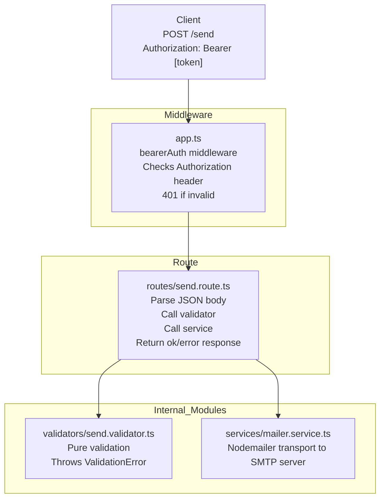

# Architecture

## Request flow

## Module responsibilities

| Module                         | Responsibility                                         | Touches                        |
| ------------------------------ | ------------------------------------------------------ | ------------------------------ |
| `index.ts`                     | Bun HTTP server bootstrap                              | `Bun.serve` via default export |
| `app.ts`                       | Hono instance, global middleware, route mounting       | `hono`, `hono/bearer-auth`     |
| `routes/send.route.ts`         | HTTP concerns — parse, validate, call service, respond | `Hono`, validator, service     |
| `validators/send.validator.ts` | Pure request-body validation                           | Nothing else                   |
| `services/mailer.service.ts`   | SMTP transport, `sendMail()`                           | `nodemailer` only              |
| `config/env.ts`                | Environment variable parsing + defaults                | `process.env`                  |
| `types/index.ts`               | Shared TypeScript interfaces                           | Nothing else                   |

## Error handling strategy

| Layer              | Handles                                                                 |
| ------------------ | ----------------------------------------------------------------------- |
| **Route**          | Catches `ValidationError` → `400`, SMTP errors → `502`, unknown → `500` |
| **Validator**      | Throws `ValidationError` with caller-safe messages                      |
| **Service**        | Lets SMTP errors bubble up to the route                                 |
| **App middleware** | Hono `bearerAuth` returns `401` automatically                           |
